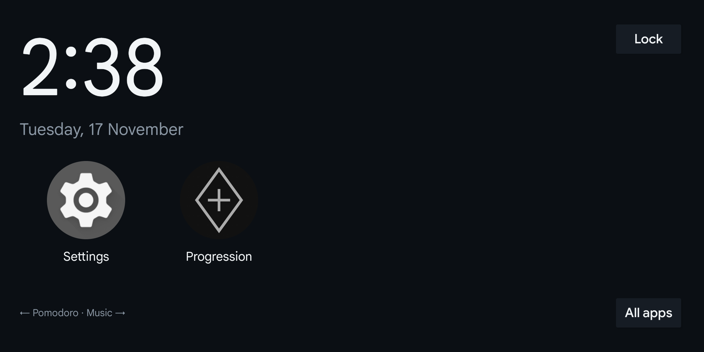
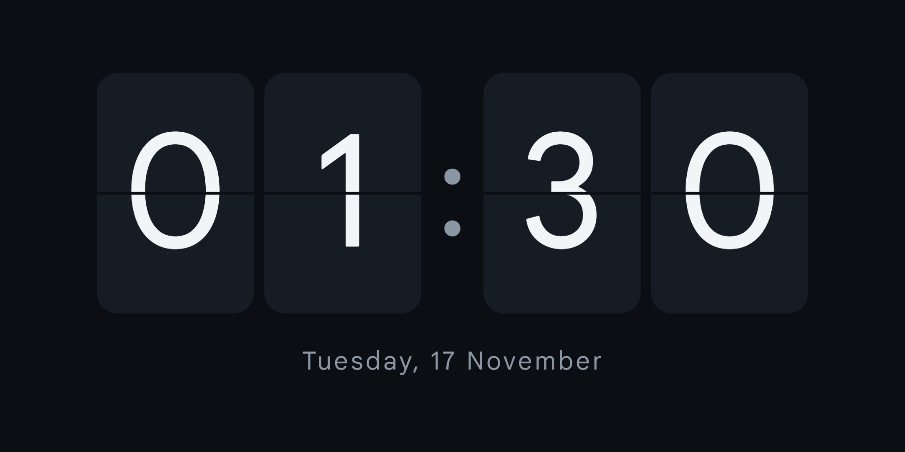
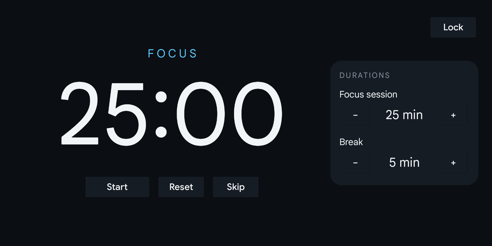
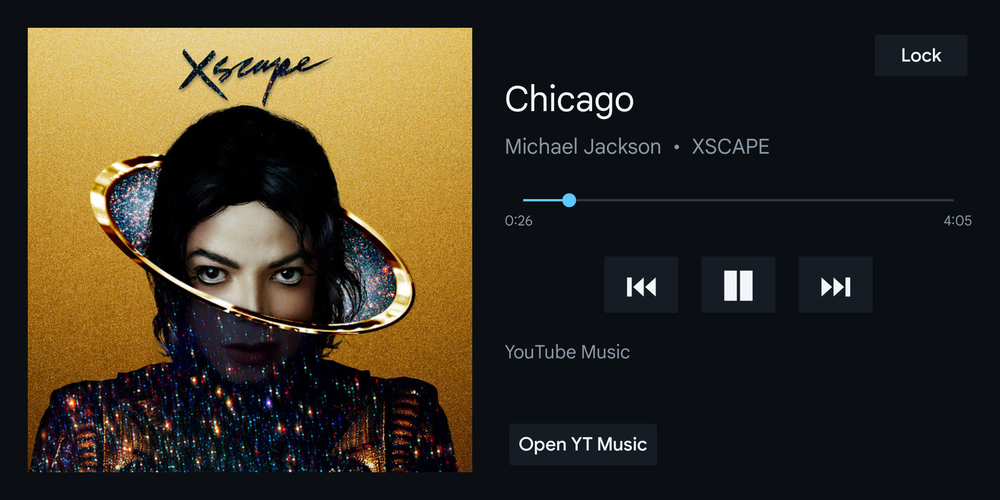

# phonedock

Turn an old Xiaomi Redmi Note 5 / Redmi 5 Plus (`vince`) into a single-purpose
home dock: a clock, a pomodoro timer, a YouTube Music controller, and a few
app tiles, running on clean Android 15 instead of MIUI.

This repo is a follow-along guide plus the source of **Dock**, the small
launcher app that replaces the home screen.

| Home | Flip clock |
| --- | --- |
|  |  |

| Pomodoro | Music |
| --- | --- |
|  |  |

Everything below was done on a Windows laptop with the phone over USB. The
commands are shown for Git Bash on Windows; they are the same on macOS and
Linux apart from paths.

> **Warning.** Flashing a custom ROM wipes the phone and voids any warranty.
> This guide is for `vince` only. The Redmi Note 5 **Pro** is `whyred` and
> needs different files. Flashing `vince` files to `whyred`, or the reverse,
> can brick the phone. Always check the codename in step 3 before flashing.

---

## What you need

- Redmi Note 5 (India) or Redmi 5 Plus, codename `vince`, with an unlocked
  bootloader. Unlocking is done with Xiaomi's official
  [Mi Unlock](https://en.miui.com/unlock/) tool and is not covered here.
- A USB cable and a computer. If fastboot is flaky on a USB 3 port, use a USB 2
  port or hub.
- Battery above 50 percent before flashing.
- About 2 GB of free disk space for the ROM and tools.

The phone's own values from this build are in [docs/device-notes.md](docs/device-notes.md).

---

## Part 1: Install adb and fastboot

Download Google's official
[SDK Platform-Tools for Windows](https://developer.android.com/tools/releases/platform-tools)
and extract to `C:\platform-tools`. Then check:

```bash
/c/platform-tools/adb version
/c/platform-tools/fastboot --version
```

The rest of the guide assumes you run `adb` and `fastboot` from that folder.

## Part 2: Enable USB debugging on the phone

On the phone: Settings, About phone, tap *MIUI version* seven times. Then
Settings, Additional settings, Developer options. Turn on **USB debugging**
and **OEM unlocking**.

Plug in the phone and run:

```bash
adb devices
```

Accept the "Allow USB debugging" prompt on the phone. The device should be
listed as `device`, not `unauthorized`.

## Part 3: Confirm the codename

This is the step that keeps you from bricking the phone.

```bash
adb shell getprop ro.product.device
adb shell getprop ro.build.version.incremental
adb shell "grep MemTotal /proc/meminfo"
```

The first line must print `vince`. Then reboot to the bootloader and check
again with fastboot:

```bash
adb reboot bootloader
fastboot devices
fastboot getvar product
fastboot getvar unlocked
```

You want `product: vince` and `unlocked: yes`. If the product is anything else,
stop here.

To let the phone charge while you download the ROM, send it back to Android:

```bash
fastboot reboot
```

## Part 4: Download the ROM and recovery

The ROM is Evolution X 10.9 (Android 15) for `vince`, official build, Google
apps included. The device page is https://evolution-x.org/device/vince and the
"Flashing Instructions" panel there is the source for the steps in Part 5.

Download both files from the Evolution X CDN:

```bash
cd ~/Documents/Redmi
curl -L -A "Mozilla/5.0" -o EvolutionX-15.0-20251001-vince-10.9-Official.zip \
  "https://cdn.evolution-x.org/vince/15/EvolutionX-15.0-20251001-vince-10.9-Official.zip/download"
curl -L -A "Mozilla/5.0" -o recovery.img \
  "https://cdn.evolution-x.org/vince/15/recovery/recovery.img/download"
```

Verify the ROM against the checksums the project publishes in its
[OTA metadata](https://raw.githubusercontent.com/Evolution-X/OTA/vic/builds/vince.json):

```bash
md5sum EvolutionX-15.0-20251001-vince-10.9-Official.zip
sha256sum EvolutionX-15.0-20251001-vince-10.9-Official.zip
```

Expected:

```
md5     69efdc32395b1e23966ed4e7b666c255
sha256  278be67bcac471a4a8bb2210aac7f7537b6c45063c2a81edda39f72e213212a9
```

The recovery image has no published checksum. Check that it starts with the
`ANDROID!` boot image header:

```bash
xxd recovery.img | head -1
```

### Firmware

The ROM has no stated firmware requirement, and the maintainer says the
releases include firmware. One XDA user reported needing MIUI 11.0.2.0, which
is the last global MIUI for this phone. If `ro.build.version.incremental` in
Part 3 showed `V11.0.2.0.OEGMIXM` or similar, you are fine.

## Part 5: Flash the recovery and boot into it

Back to the bootloader:

```bash
adb reboot bootloader
fastboot flash recovery recovery.img
```

Now the one gotcha on this phone. The official instructions say
`fastboot reboot recovery`, but the `vince` bootloader ignores that and boots
MIUI instead. Worse, MIUI then quietly restores its own recovery over the one
you just flashed. So:

1. **Press and hold Volume Up on the phone.**
2. While holding it, run:
   ```bash
   fastboot reboot
   ```
3. Keep holding Volume Up until the Evolution X recovery menu appears, usually
   10 to 20 seconds.

If you end up in MIUI anyway, reflash the recovery and try again. It worked on
the second try here.

## Part 6: Format and install

In the Evolution X recovery, volume keys move and the power key selects.

1. Choose **Factory reset**, then **Format data/factory reset**, and confirm.
   This erases everything.
2. Go back to the main menu, choose **Apply update**, then **Apply from ADB**.
3. On the computer, check the phone shows up in sideload mode and send the ROM:
   ```bash
   adb devices
   adb sideload EvolutionX-15.0-20251001-vince-10.9-Official.zip
   ```
   The computer side stops at around 47 percent and prints `Total xfer: 1.00x`.
   That is normal for this recovery. The phone should say
   `Install completed with status 0`.
4. Choose **Reboot system now**. First boot takes several minutes.

When the Android setup screens appear, go through them, sign in to Google,
and connect Wi-Fi. You can remove the SIM; nothing in the dock needs it.

Finally, re-enable USB debugging on the new ROM: Settings, About phone, tap
*Build number* seven times, then Settings, System, Developer options.

---

## Part 7: Build the Dock app

Dock is a small Kotlin app in [dock/](dock). It needs a JDK, the Android SDK,
and Gradle. Android Studio is not required.

1. Install a JDK 17. On Windows:
   ```bash
   winget install --id Microsoft.OpenJDK.17 -e
   ```
2. Download the
   [Android command-line tools](https://developer.android.com/studio#command-line-tools-only)
   and extract so that you end up with `C:\android-sdk\cmdline-tools\latest\bin`.
3. Install the platform and build tools. Use PowerShell or cmd for this one,
   because Git Bash mangles the `--sdk_root` path:
   ```
   C:\android-sdk\cmdline-tools\latest\bin\sdkmanager.bat --sdk_root=C:\android-sdk --licenses
   C:\android-sdk\cmdline-tools\latest\bin\sdkmanager.bat --sdk_root=C:\android-sdk "platforms;android-35" "build-tools;35.0.0" "platform-tools"
   ```
   Check that `C:\android-sdk\platforms\android-35` exists afterwards.
4. Download [Gradle 8.9](https://gradle.org/releases/) (binary only) and
   extract to `C:\gradle\gradle-8.9`.
5. Copy `dock/local.properties.example` to `dock/local.properties` and set
   `sdk.dir` if your SDK is somewhere else.
6. Build:
   ```bash
   export JAVA_HOME="/c/Program Files/Microsoft/jdk-17.0.21.21-hotspot"
   export PATH="$JAVA_HOME/bin:/c/gradle/gradle-8.9/bin:$PATH"
   export ANDROID_HOME=/c/android-sdk
   cd dock
   gradle assembleDebug --no-daemon
   ```
   The first build downloads the Android Gradle plugin and takes a few minutes.
   The APK lands in `dock/app/build/outputs/apk/debug/app-debug.apk`.

## Part 8: Install Dock and make it the home screen

```bash
adb install -r dock/app/build/outputs/apk/debug/app-debug.apk
```

Dock needs three things that are easiest to grant over adb:

```bash
# Make Dock the home app (both the preferred activity and the HOME role)
adb shell cmd package set-home-activity app.vince.dock/.MainActivity
adb shell cmd role add-role-holder android.app.role.HOME app.vince.dock

# Notification access, so the music page can see what YouTube Music is playing
adb shell cmd notification allow_listener app.vince.dock/.MediaListener

# Device admin, so the Lock button can turn the screen off
adb shell dpm set-active-admin app.vince.dock/.DockAdmin
```

Then launch it:

```bash
adb shell am start -n app.vince.dock/.MainActivity
```

Install YouTube Music from the Play Store if you want the music page to do
anything.

## Part 9: Using Dock

Dock is landscape only and keeps the screen on while it is showing.

- **Home** (middle page): time and date, your pinned apps as large
  black-and-white tiles, and an *All apps* button. Tap the time for a
  full-screen flip clock; tap anywhere on the clock to go back.
- **Pomodoro** (swipe right): start, reset, skip, and a card to change the
  focus and break lengths. Lengths are saved. A chime plays when a session ends.
- **Music** (swipe left): artwork, title, seek bar, previous, play/pause, next.
  It follows the active media session and prefers YouTube Music.
- **Lock** (top right on every page): turns the screen off. If you set a PIN in
  Settings, Security, the Lock button enforces it.
- **Pinning**: in *All apps*, long-press any app to pin or unpin it on the home
  page. Long-press a home tile to unpin it. Pinned shortcuts from other apps,
  such as a PWA added from Chrome, work too.

## Part 10: Adding a web app (PWA)

Open the site in Chrome, use the three-dot menu, and choose
**Install and create shortcut** (or *Add to Home screen* on older Chrome).
After the two confirmation dialogs, the app appears in *All apps* and can be
pinned.

If the menu has no install entry at all, force-stop Chrome and open the site
again. Chrome checks once per process whether the home app supports pinned
shortcuts and caches the answer, so a Chrome that was already running before
Dock was installed will keep hiding the option.

```bash
adb shell am force-stop com.android.chrome
adb shell am start -a android.intent.action.VIEW -d "https://your-site.example/" com.android.chrome
```

Also double-check the address. A typo like `vercell.app` instead of
`vercel.app` lands on a parked page that has no manifest to install.

---

## Troubleshooting

**The phone boots to MIUI after `fastboot reboot recovery`.**
Expected on `vince`. Reflash the recovery and hold Volume Up during
`fastboot reboot` (Part 5).

**Dock crashed on first launch with a StackOverflowError.**
Fixed in the current source. The media code called itself recursively when
notification access was not yet granted.

**Apps feel choppy, or Chrome and the Play Store seem to crash.**
This is memory pressure on a 4 GB phone, not real crashes. Check with:

```bash
adb shell "dumpsys meminfo | grep -E 'Total RAM|Free RAM'"
adb logcat -d -s lowmemorykiller:* | tail
```

Dock itself uses about 70 MB. The fixed costs are the system, Google Play
Services and System UI. Two optional savings are disabling the ROM's face
unlock service (`co.aospa.sense`) and the unused Pixel Launcher
(`com.google.android.apps.nexuslauncher`) from Settings, Apps.

**Fingerprint enrolment never starts.**
On this ROM build the vendor fingerprint service crashes with a segmentation
fault every time Android opens a session with it (visible in
`adb logcat -b crash`). It is a ROM bug with the Goodix driver, not a settings
problem, and cannot be fixed from the phone. The dock does not need it.

**Screenshots over adb come out black.**
The screen is off or the lock screen is showing. Wake and dismiss it first:

```bash
adb shell input keyevent KEYCODE_WAKEUP
adb shell wm dismiss-keyguard
adb exec-out screencap -p > screen.png
```

**Something went badly wrong.**
As long as the bootloader is intact the phone can still enter fastboot mode
(Power + Volume Down from off). The way back is Xiaomi's stock MIUI fastboot
ROM for `vince` flashed with the Mi Flash tool. Never relock the bootloader
unless you are back on fully stock MIUI.

---

## Repo layout

```
dock/                 Android project for the Dock launcher (Kotlin, no Compose)
docs/device-notes.md  Values recorded from the phone used for this guide
docs/images/          Screenshots of the dock pages
```

Built with Android Gradle Plugin 8.7.3, Kotlin 2.0.21, compileSdk 35,
minSdk 30.
